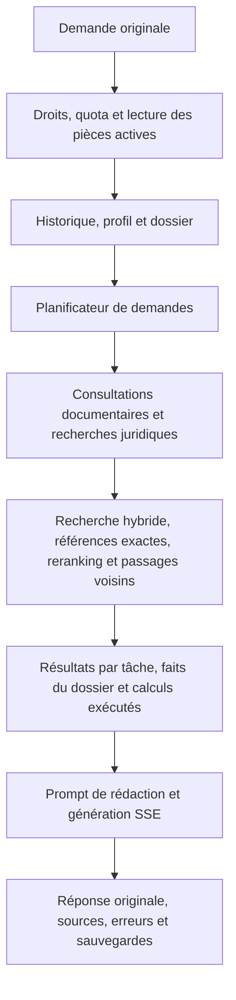

# Audit des réponses et référence de comparaison

Le premier lot établit une référence technique du parcours réel du chat, une
matrice de situations à examiner et un ordre de travail pour améliorer les
réponses sans perdre les comportements utiles. Il corrige aussi une perte de
texte reproduite lors d'une interruption du flux fournisseur.

Les captures de ce lot utilisent des transports simulés et un corpus synthétique.
Elles vérifient l'instrument de comparaison. Elles ne démontrent ni amélioration
juridique, ni gain de pertinence, de coût ou de latence sur le corpus réel.

## Parcours à observer



L'orchestrateur borne l'exécution à deux passages, six actions et trois recherches
juridiques. Les recherches indépendantes peuvent être parallèles. Chaque branche
dispose de son agent et de ses diagnostics ; les encodages identiques sont déjà
partagés dans une préparation de recherche. Ces mécanismes doivent être mesurés
avant de proposer davantage de parallélisme ou de cache.

## Constats et priorités

| Priorité | Constat | Niveau de preuve | Travail associé |
| --- | --- | --- | --- |
| P0 | Un fragment reçu peut rester dans le tampon de génération et être perdu si le fournisseur lève une exception. | Reproduit sur le vrai endpoint ; corrigé dans ce lot. | Conserver le fragment original avant de propager l'erreur. |
| P1 | Le rejeu administrateur appelle directement le RAG, tandis que le chat utilise l'orchestrateur et le dossier. | Confirmé dans les points d'entrée. | Employer le chemin du chat dans l'environnement de comparaison. |
| P1 | Des consignes du prompt se contredisent sur l'absence de dispositions et la validité des références historiques. | Audit statique ; effet sur les réponses à mesurer. | Comparer de petites variantes sur les mêmes cas et sources. |
| P1 | La suffisance du contexte dépend de la récupération, du classement et des budgets de passages. | Budgets identifiés ; rappel documentaire réel non mesuré. | Examiner où disparaît une disposition indispensable. |
| P2 | La formule de coût ignore la distinction des tokens de cache ; un modèle inconnu vaut zéro dans le suivi. | Confirmé dans le code. | Distinguer coût estimé, consommation inconnue et coût fournisseur avant les comparaisons économiques. |
| P2 | Une erreur de recherche peut être transmise comme erreur d'une branche à la rédaction, sans erreur SSE terminale. | Observé dans la capture HTTP. | Inclure les incidents de branches dans l'audit ; ne pas compter seulement les fins de réponse. |

### Perte de texte corrigée

Le premier fragment est transmis immédiatement. Les suivants sont regroupés par
lots avant d'être envoyés. Le tampon résiduel n'était vidé qu'à la fin normale du
flux : une exception sautait cette étape.

Sur le scénario synthétique d'interruption, le modèle simulé fournit 58 caractères.
Avant correction, 27 sont envoyés et sauvegardés. Après correction, les 58 sont
conservés exactement et l'interruption est signalée séparément. Aucun nouvel appel
au modèle, texte de remplacement ou traitement éditorial n'est introduit.

La correction porte sur les exceptions du flux fournisseur. Elle ne change pas
les délais d'inactivité ni la politique d'annulation. Le cas d'un tampon encore
rempli au moment d'une annulation par la garde d'inactivité reste un point distinct
à examiner ; les tests historiques des gardes portent surtout sur le texte déjà
émis par le générateur.

Référence : [génération](../../backend/app/rag/agent.py),
[tests des frontières du tampon](../../backend/tests/test_rag_stream_preservation.py).

### Contradictions de consignes à comparer

Dans le prompt de génération :

- La règle commune interdit de conclure à l'absence d'une disposition à partir
  d'une sélection de passages. La méthode propose pourtant la phrase « Aucun
  accord d'entreprise ne prévoit de disposition différente dans vos sources ».
- La continuité affirme qu'une source citée au tour précédent reste valable.
  Le bloc des sources historiques précise, lui, que leur pertinence et leur
  applicabilité au nouveau sujet ne sont pas établies par leur présence.
- La récence demande de retenir « TOUJOURS » la date d'effet la plus récente.
  Une question portant sur une situation passée doit être examinée séparément.
- Les exemples contiennent des conventions, chiffres et références précis.
  Leur influence éventuelle sur une organisation différente reste à vérifier.

Ces observations justifient des expériences ciblées. Elles ne suffisent pas à
choisir une reformulation gagnante. Aucun prompt n'est modifié dans ce lot.

Référence : [assemblage des prompts et du contexte](../../backend/app/rag/agent.py).

### Recherche et conservation du contexte

Chaque recherche conserve au maximum dix groupes parents après classement. Pour
les groupes soumis au budget de caractères, les passages sont conservés entiers
dans la limite de 9 000 caractères ; les décisions de jurisprudence ont un
traitement distinct. Ces plafonds ne sont pas une mesure de pertinence.

L'audit documentaire doit distinguer :

1. source non collectée ou version absente ;
2. source inaccessible au cas ou exclue par un filtre ;
3. passage absent des candidats ;
4. passage candidat mal classé ou groupe exclu par le budget ;
5. passage utile présent dans le contexte mais mal utilisé en rédaction.

L'historique récent est limité à six messages. La génération conserve leur texte
intégral avec un dossier ; le chemin sans ce contexte peut encore limiter chaque
message à 2 000 caractères. Le rejeu simple ne reproduit donc pas forcément la
correction d'un long document telle qu'elle se déroule dans le chat.

Références : [recherche](../../backend/app/rag/search.py),
[groupes parents](../../backend/app/rag/parent_expansion.py),
[orchestrateur](../../backend/app/services/conversation_orchestrator.py),
[rejeu administrateur](../../backend/app/api/admin_quality.py).

## Référence technique disponible

L'outil [audit_answers.py](../../backend/scripts/audit_answers.py) passe par
`POST /api/v1/conversations/{id}/chat/stream` et les fonctions applicatives réelles.
Les dépendances de développement du backend sont nécessaires.

Les huit scénarios techniques couvrent une recherche simple, deux recherches
parallèles, une rédaction seule, la reprise d'un mail long, une correction de fait,
un plan inexécutable, une panne de recherche et une génération interrompue.

L'isolation repose sur la base SQLite de tests et Qdrant en mémoire. Le modèle,
les embeddings et le reranking sont simulés à leurs frontières ; la recherche,
les filtres, le classement des résultats reçus, l'expansion et les sauvegardes
utilisent le code applicatif. Les connexions réseau et aux bases non SQLite sont
interdites pendant les scénarios. Le processus de capture reçoit en plus des
identifiants factices et des endpoints sans accès aux services applicatifs.

Les réponses simulées servent uniquement à tester la fidélité du transport. Elles
ne constituent pas des réponses de référence juridique. Les parcours de pièces
privées, de calcul, de dossier nommé et de catalogue chronologique ne sont pas
encore capturés dans ces huit scénarios ; leurs tests existants restent séparés.

### Utilisation

Depuis `backend/` :

```sh
.venv/bin/python -m scripts.audit_answers capture \
  --output ../tmp/answer-reference-a

.venv/bin/python -m scripts.audit_answers capture \
  --output ../tmp/answer-reference-b

.venv/bin/python -m scripts.audit_answers compare \
  ../tmp/answer-reference-a ../tmp/answer-reference-b \
  --output ../tmp/answer-comparison.json
```

Chaque capture utilise un nouveau répertoire privé. Les fichiers sont créés sans
écrasement, avec des droits `0600`, dans un répertoire `0700`. Elle contient :

- `protocol.json` : les situations et leur périmètre de revue ;
- `manifest.json` : commit, état du répertoire de travail, empreintes du code,
  versions des dépendances et limites de l'expérience ;
- `source_bundle.zip` : les sources du backend et de l'outil nécessaires à cette
  référence, y compris les changements locaux, sans fichier `.env` ni accès prod ;
- `case-*.json` : entrées, requêtes modèle exactes, sorties originales, corpus,
  requêtes et réponses de l'index local, résultats du reranker, octets SSE, erreurs,
  avertissements et état final des messages et du dossier ;
- `completion.json` : résultat des contrôles techniques et empreintes des fichiers.

Les erreurs restent archivées. Une capture échouée ou incomplète n'est pas promue
en référence complète. Une modification des sources pendant la capture est
également signalée.

La comparaison vérifie l'intégrité des fichiers, le protocole, les entrées par cas,
les versions des dépendances, les paramètres de modèle et la date de référence.
Elle affiche les changements de statuts, incidents, nombre d'appels et égalité des
textes simulés. Une différence
de code est attendue entre variantes ; les sources de chacune sont archivées.
Les identifiants et horodatages créés par l'application peuvent varier.

`compatible_inputs=true` signifie que les entrées comparées sont compatibles.
Cela ne signifie jamais « meilleure réponse » ou « absence de régression juridique ».
Les coûts et latences fournisseur restent inconnus dans ce mode ; les temps locaux
ne doivent pas être présentés comme des mesures de production.

Les répertoires `tmp/` du projet sont ignorés par Git et restent locaux. Les
captures utiles doivent être conservées dans une sauvegarde privée durable pour
servir à une campagne ultérieure ; elles ne sont pas publiées par cet outil.

## Matrice pour la revue des réponses

Les vingt situations sont définies dans
[answer_cases.json](../../backend/scripts/audit/answer_cases.json). Elles couvrent
questions simples, checklists, livrables multiples, convention inconnue ou contestée,
sources internes, droit historique, actualités, référence exacte, relance,
changement de sujet, calcul, mail seul, correction d'un long document, pièce jointe,
source non retrouvée, correction de fait et erreurs techniques.

Les questions de revue sont des aides à une lecture humaine. Aucune note par
mots-clés, regex ou autre modèle n'est calculée. Elles ne filtrent ni ne réécrivent
les réponses et ne déclenchent aucune relance corrective.

## Prochaines étapes avant une optimisation sémantique

1. Compléter les captures par les branches de pièces privées, calculs, dossiers
   nommés et chronologies. Préparer un instantané autorisé et versionné du corpus
   réel et des profils, distinct des données de production modifiables.
2. Inclure des réponses déjà satisfaisantes et des incidents constatés. Pour
   chaque cas, conserver les sources recherchées et celles réellement transmises.
   Faire préciser les points décisifs par une revue juridique humaine.
3. Établir une référence réelle avec appels explicitement bornés, originaux
   conservés et incidents comptés. Mesurer premier texte, durée totale, coût
   estimé avec ses limites, tokens et nombre d'appels par étape. Les mêmes sources
   et entrées servent aux comparaisons ; un essai supplémentaire avec recherche
   complète mesure ensuite les effets sur la sélection documentaire.
4. Comparer une modification à la fois et conserver des cas supplémentaires qui
   n'ont pas servi à concevoir la variante. Répéter les situations sensibles avec
   un ordre alterné pour limiter les effets de charge et de cache.
5. Rejeter les régressions critiques observées : mauvais régime, mauvaise date,
   référence inventée, perte d'un fait décisif, mauvais destinataire ou fuite de
   données. Présenter séparément les arbitrages de coût, délai et utilité ; une
   moyenne favorable ne compense pas une nouvelle erreur critique.

La première expérience de prompt devrait cibler une seule contradiction, par
exemple l'absence de disposition. Changement de modèle, réduction du contexte et
refonte de l'orchestration restent des expériences distinctes.

## Vérifications du lot

Les deux anciens tests de poursuite après panne ont été alignés sur le contrat
technique actuel du RAG : une recherche auxiliaire réussie ne masque pas la panne
d'une branche principale. Les recherches et leur politique d'erreur ne sont pas
modifiées. Le comportement propre à l'orchestrateur est observé séparément dans
les captures HTTP.

Les tests ajoutés vérifient la conservation des fragments aux frontières du tampon,
les événements et sauvegardes du parcours HTTP, l'intégrité des archives et les
incompatibilités entre captures. Ils n'évaluent aucun contenu juridique généré.

Suite ciblée élargie : **179 tests réussis, 1 ignoré**. Elle couvre les nouveaux
outils, les prompts, l'orchestration, les demandes, le rejeu simple, la recherche,
les groupes parents, les gardes de streaming, les parcours de pièces jointes,
l'observabilité de la démo et les compteurs d'usage. Ruff ciblé et
`git diff --check` réussis.

Après les derniers contrôles d'intégrité et de décodage Unicode, les **13 tests
de l'outil** et une nouvelle **capture de huit scénarios** réussissent également.
La comparaison entre les captures de référence et finale trouve huit cas avec
entrées compatibles et textes simulés identiques. Cette égalité vérifie le banc,
pas la qualité juridique d'une variante de prompt.

Les éléments locaux de cette exécution sont conservés dans :

- `tmp/answer-audit-20261026-final/` : capture complète avec 216 fichiers source
  archivés et aucun fichier `.env` ;
- `tmp/answer-audit-20261026-comparison.json` : comparaison technique ;
- `tmp/answer-audit-20261026-before/` : première capture de diagnostic, marquée
  échouée, où la perte de tampon est visible. Elle contient aussi deux assertions
  initiales de l'outil rectifiées pour refléter les champs et le contrat réels.

Les droits du répertoire final sont `0700` et ceux de ses fichiers `0600`.

Aucun déploiement ni appel fournisseur payant n'est effectué dans ce lot.
